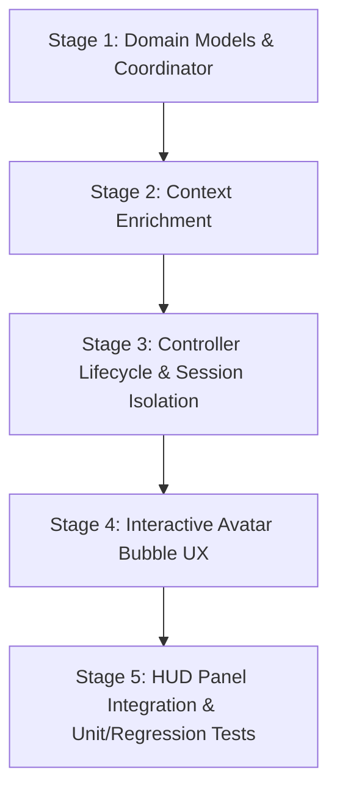

# Phase 4 — Contextual Conversation Implementation Plan

**Project:** AI Visual Tutor for Blender  
**Branch:** `feature/frontend-dev`  
**Baseline Commit:** `4ed19ad44b2d97885bd5a54513ed9cc1b0fbebeb`  
**Date:** October 15, 2026  
**Status:** **READY FOR IMPLEMENTATION (PENDING USER REVIEW)**  
**Document Location:** `docs/validation/PHASE_4_IMPLEMENTATION_PLAN.md`  
**Accompanying Research:** [`docs/reference/PHASE_4_CONTEXTUAL_CONVERSATION_RESEARCH.md`](file:///c:/Users/PC/Desktop/AIVisualTutor/docs/reference/PHASE_4_CONTEXTUAL_CONVERSATION_RESEARCH.md)

---

## 1. Executive Summary

The AI Visual Tutor has completed foundational phases covering procedural 3D avatar rendering, transparent desktop window compositing, dynamic target docking, screen-space plasma tether guidance, harmonic pulse synchronization, and live Blender 5.2.2 LTS telemetry over loopback port `47629` (with 692 passing tests).

This document specifies the exact, file-by-file implementation plan for **Phase 4: Contextual Conversation**. 

### Core Objectives
1. **Contextual Grounding:** Ground conversational queries in active user goals, current tutorial step instructions, live Blender scene graph observations (mode, selected objects, counts), and verification failure diagnostics.
2. **Multi-Turn Continuity:** Enable learners to ask follow-up questions directly within the avatar's floating `InstructionBubble` as well as the workspace `ChatbotPanel`.
3. **Session & Task Isolation:** Guarantee that switching tutorial steps or starting new goals immediately cancels in-flight queries and prevents stale context from bleeding across steps.
4. **Resilient Failure Handling:** Provide smooth fallback to offline guidance upon network timeouts or API key absence, with interactive cancellation affordances.
5. **Architectural Separation of Powers:** Maintain the tutoring controller and Blender verification workflow as the sole authoritative truth. Conversational advice must remain strictly non-executable and never independently advance tutorial progress.

---

## 2. Current Architecture vs. Target Architecture

### 2.1 Current As-Is Data Flow ("Explain More")
Currently, `InstructionBubble` has an `[ 📖 Explain more ]` button that functions as a single-turn explanation card:

```
[User clicks "Explain more"]
        │
        ▼
AvatarWindow.kt (onExplainClick)
        │
        ├── Builds ephemeral query string: "Explain step: ${step.title}. ${step.instruction}"
        ├── Calls ChatContextBuilder.buildContext(question, controller)
        │     └── OMITS observedState, chatHistory, appContext
        ├── Dispatches to SmartChatbotProvider.askTutor(chatContext)
        │     └── Groq / Gemini / Offline fallback
        └── Assigns response to local Composable state:
              var explanationText by remember { mutableStateOf<String?>(null) }
```

**Critical Deficiencies in Current Flow:**
- **No Multi-Turn:** The user cannot ask a follow-up question ("Where do I find that?", "Why did it fail?").
- **No Scene Telemetry:** The query does not know if the user is in Object Mode or Edit Mode, or if the target object exists.
- **Unowned History:** History is stored in local Composable memory inside `ChatbotPanel` and wiped on close; `AvatarWindow` explanations are never saved to history.
- **No Task Cancellation:** If the user advances to Step 2 while Step 1 explanation is in flight, Step 1 advice arrives and contaminates Step 2.

---

### 2.2 Proposed Target Data Flow (Phase 4)
Phase 4 introduces a domain-level `TutorConversationCoordinator` inside `TutorController`, mirroring the proven architecture of `ScreenshotHelpCoordinator` and `ClosedLoopRecoveryCoordinator`:

```
┌────────────────────────────────────────────────────────────────────────┐
│                        USER INTERFACE LAYER                            │
│                                                                        │
│   AvatarWindow / InstructionBubble             Workspace ChatbotPanel  │
│   - Multi-turn bubble thread                   - Persistent full chat  │
│   - In-bubble follow-up input                  - Goal initiation       │
│   - Thinking spinner + [Cancel]                - System diagnostics    │
└──────────────────┬─────────────────────────────────┬───────────────────┘
                   │                                 │
                   ▼                                 ▼
┌────────────────────────────────────────────────────────────────────────┐
│                   TUTOR CONVERSATION COORDINATOR                       │
│                   (Domain Layer / TutorController)                     │
│                                                                        │
│   - Owns authoritative conversation message history (List<ChatMessage>)│
│   - Tracks reactive TutorConversationState (Idle, Thinking, Error)     │
│   - Manages Mutex-guarded query dispatch and in-flight Job lifecycle   │
│   - Listens to step index & goal changes -> cancels in-flight jobs     │
│   - Tags messages with stepIndex & goalId for session isolation        │
└──────────────────┬─────────────────────────────────────────────────────┘
                   │
                   ▼
┌────────────────────────────────────────────────────────────────────────┐
│                 CONTEXT BUILDER & TELEMETRY INGESTION                  │
│                                                                        │
│   Enriches query context with:                                         │
│   - Active Goal & Step Instruction                                     │
│   - Live Blender ObservedState (Mode, Active Object, Location)         │
│   - Last Verification Diagnostic Report (MismatchCategory, Cause)      │
│   - Active Pedagogical Outcome (Competence, Adaptation Rationale)      │
│   - Recent Step Dialogue (Last 6 messages)                             │
└──────────────────┬─────────────────────────────────────────────────────┘
                   │
                   ▼
┌────────────────────────────────────────────────────────────────────────┐
│                 SMART CHATBOT ROUTER & FALLBACK                        │
│                                                                        │
│   - Groq Cloud API (gpt-oss-120b) via ApiKeyConfig                     │
│   - Google Gemini Multimodal via ApiKeyConfig                          │
│   - Offline Domain Knowledge Engine (15s timeout / missing key fallback)│
└────────────────────────────────────────────────────────────────────────┘
```

---

## 3. Existing Behavior vs. Missing Behavior

| Capability | Current Baseline | Missing / Target Behavior in Phase 4 |
| :--- | :--- | :--- |
| **Explain More Action** | Works as single-shot card for active step title/instruction. | Preserved, but integrated into multi-turn dialogue with follow-up input. |
| **Follow-Up Questions** | None in avatar bubble; only top-level queries in HUD drawer. | Interactive follow-up input inside `InstructionBubble` maintaining conversational context. |
| **Live Blender Telemetry** | Unused by `AvatarWindow.kt` and `ChatbotPanel.kt`. | Live `ObservedState` automatically fed from `controller.sessionContext.lastObservedState`. |
| **Verification Failure Awareness** | Chatbot unaware of why verification failed. | `controller.diagnoseCurrentStep()` and failure rationale included in context. |
| **Session & Step Scoping** | In-flight requests leak across steps; panel messages lost on close. | Authoritative `TutorConversationCoordinator` with step tagging and cancellation on step switch. |
| **User Query Cancellation** | Cannot cancel pending LLM request. | Explicit `[ ✕ Cancel ]` button cancels active coroutine job and restores Idle state. |
| **Credential Management** | `ApiKeyConfig` supports runtime, `.env`, `local.properties`. | Fully reused without changes or redundant storage. |
| **Authoritative Verification** | LLM cannot complete steps. | Strict isolation maintained: LLM responses are advisory only. |

---

## 4. Proposed Context Contract

The minimal, structured context contract ensures high accuracy without payload bloat or latency penalties:

```kotlin
package chat

import context.ObservedState
import java.awt.image.BufferedImage
import java.time.Instant

enum class ConversationSource {
    AVATAR_BUBBLE,
    WORKSPACE_PANEL,
    SYSTEM
}

data class StructuredTutorContext(
    val question: String,
    val applicationName: String,
    val goalTitle: String?,
    val stepIndex: Int,
    val totalSteps: Int,
    val stepTitle: String,
    val stepInstruction: String,
    val targetControlName: String?,
    val blenderMode: String?,
    val activeObjectName: String?,
    val activeObjectLocation: String?,
    val totalSceneObjects: Int,
    val lastVerificationStatus: String?,
    val lastFailureReason: String?,
    val recentDialog: List<ChatMessage>,
    val screenshotCrop: BufferedImage? = null,
    val includeVisualContext: Boolean = false
)
```

### Context Size & Latency Budget
- **Token Estimate:** $180\text{–}250$ tokens.
- **Groq API Latency:** $250\text{–}450\text{ ms}$ (optimal for snappy interactive tutoring).
- **Gemini API Latency:** $800\text{–}1400\text{ ms}$.
- **Offline Fallback Latency:** $<10\text{ ms}$.

---

## 5. Proposed Implementation Stages & Dependencies



### Stage 1: Domain Models & Conversation Coordinator
- Define `TutorConversationModels.kt` (`TutorConversationState`, `ConversationSource`).
- Extend `ChatMessage` in `ChatModels.kt` with `stepIndex`, `goalId`, and `source`.
- Create `TutorConversationCoordinator.kt` with thread-safe `Mutex`, `Job` cancellation, message repository, and delegation to `SmartChatbotProvider`.

### Stage 2: Context Enrichment & Live Telemetry Wiring
- Update `ChatContextBuilder.kt` to automatically default `observedState` to `controller.sessionContext.lastObservedState`.
- Incorporate `controller.diagnoseCurrentStep()` and `state.adaptationReason` into `ChatContext`.
- Ensure multi-turn dialogue history is pruned to the most recent 6 messages of the current step.

### Stage 3: Controller Lifecycle & Task Isolation
- Add `conversationCoordinator` to `TutorController.kt` with factory pattern.
- In `TutorController`: hook step transition methods (`goToStep`, `nextStep`, `previousStep`, `startUserGoal`, `clearUserGoal`) to invoke `conversationCoordinator.onStepChanged()`, cancelling in-flight queries and isolating step conversations.

### Stage 4: Interactive Avatar Bubble UX (`InstructionBubble.kt`)
- Extend the explanation card in `InstructionBubble.kt`:
  - Display the conversational thread for the active step.
  - Add an inline follow-up text field ("Ask follow-up...").
  - Provide Send and Cancel buttons.
  - Display a clean loading indicator with cancellation support while thinking.
- Wire `AvatarWindow.kt` to bind to `controller.conversationCoordinator`.

### Stage 5: Workspace Panel Integration & Test Verification
- Refactor `ChatbotPanel.kt` to bind its message list directly to `controller.conversationCoordinator.messages`.
- Write dedicated unit tests in `TutorConversationCoordinatorTest.kt`.
- Run full automated regression suite (`gradle test`) to verify zero regressions.

---

## 6. File-by-File Change Plan

### 6.1 Expected Changes (Core Implementation)

| File Path | Type | Planned Changes |
| :--- | :--- | :--- |
| [`composeApp/.../chat/ChatModels.kt`](file:///c:/Users/PC/Desktop/AIVisualTutor/composeApp/src/main/kotlin/chat/ChatModels.kt) | **Modify** | 1. Add `stepIndex: Int? = null`, `goalId: String? = null`, and `source: ConversationSource = ConversationSource.AVATAR_BUBBLE` to `ChatMessage`.<br>2. Define `enum class ConversationSource { AVATAR_BUBBLE, WORKSPACE_PANEL, SYSTEM }`.<br>3. Add `lastVerificationStatus: String? = null` and `lastFailureReason: String? = null` to `ChatContext`. |
| [`composeApp/.../tutor/TutorConversationModels.kt`](file:///c:/Users/PC/Desktop/AIVisualTutor/composeApp/src/main/kotlin/tutor/TutorConversationModels.kt) | **Create** | 1. Define sealed interface `TutorConversationState` (`Idle`, `Thinking(val queryId: String, val stepIndex: Int, val queryText: String)`, `Error(val message: String, val canRetry: Boolean)`).<br>2. Define session filtering helper data structures. |
| [`composeApp/.../tutor/TutorConversationCoordinator.kt`](file:///c:/Users/PC/Desktop/AIVisualTutor/composeApp/src/main/kotlin/tutor/TutorConversationCoordinator.kt) | **Create** | 1. Implements authoritative conversation coordination.<br>2. Maintains `messages: SnapshotStateList<ChatMessage>`.<br>3. Exposes reactive `state: TutorConversationState`.<br>4. Methods: `askTutor(query, source)`, `cancelActiveQuery()`, `onStepChanged(newStepIndex)`, `clearHistory()`.<br>5. Guards against duplicate clicks with `Mutex` and cancels in-flight jobs on step changes.<br>6. Enforces non-authoritative boundary (cannot advance steps). |
| [`composeApp/.../chat/ChatContextBuilder.kt`](file:///c:/Users/PC/Desktop/AIVisualTutor/composeApp/src/main/kotlin/chat/ChatContextBuilder.kt) | **Modify** | 1. Default `observedState` to `controller.sessionContext.lastObservedState` if null.<br>2. Extract mode and selected object location from live telemetry.<br>3. Ingest mismatch report summary from `controller.diagnoseCurrentStep()`.<br>4. Pass filtered step dialogue to `recentChatHistory`. |
| [`composeApp/.../tutor/TutorController.kt`](file:///c:/Users/PC/Desktop/AIVisualTutor/composeApp/src/main/kotlin/tutor/TutorController.kt) | **Modify** | 1. Add `val conversationCoordinator: TutorConversationCoordinator`.<br>2. Support factory parameter `conversationCoordinatorFactory: ((TutorController) -> TutorConversationCoordinator)? = null` for dependency injection/testing.<br>3. Call `conversationCoordinator.onStepChanged(index)` on step transitions.<br>4. Call `conversationCoordinator.onGoalChanged()` on `startUserGoal` and `clearUserGoal`. |
| [`composeApp/.../ui/avatar/InstructionBubble.kt`](file:///c:/Users/PC/Desktop/AIVisualTutor/composeApp/src/main/kotlin/ui/avatar/InstructionBubble.kt) | **Modify** | 1. Update explanation card into a multi-turn conversation thread.<br>2. Add interactive mini follow-up text field with Send affordance.<br>3. Display `[ ✕ Cancel ]` button when `isExplainBusy` is true.<br>4. Display error banner with retry affordance if conversation state is `Error`. |
| [`composeApp/.../ui/avatar/AvatarWindow.kt`](file:///c:/Users/PC/Desktop/AIVisualTutor/composeApp/src/main/kotlin/ui/avatar/AvatarWindow.kt) | **Modify** | 1. Connect `InstructionBubble` callbacks (`onExplainClick`, `onFollowUpSubmit`, `onCancelQuery`) to `controller.conversationCoordinator`.<br>2. Replace ephemeral Composable `explanationText` with reactive coordinator state. |
| [`composeApp/.../ui/ChatbotPanel.kt`](file:///c:/Users/PC/Desktop/AIVisualTutor/composeApp/src/main/kotlin/ui/ChatbotPanel.kt) | **Modify** | 1. Bind message list to `controller.conversationCoordinator.messages`.<br>2. Route queries through `controller.conversationCoordinator.askTutor(...)`.<br>3. Preserve chat history across panel open/close. |
| [`composeApp/.../tutor/TutorConversationCoordinatorTest.kt`](file:///c:/Users/PC/Desktop/AIVisualTutor/composeApp/src/test/kotlin/tutor/TutorConversationCoordinatorTest.kt) | **Create** | Unit tests covering all 10 acceptance criteria (cancellation on step change, context grounding, fallback handling, non-authoritative boundary). |

### 6.2 Optional Changes (Enhancements)

| File Path | Type | Planned Changes |
| :--- | :--- | :--- |
| [`composeApp/.../ui/TutorPanel.kt`](file:///c:/Users/PC/Desktop/AIVisualTutor/composeApp/src/main/kotlin/ui/TutorPanel.kt) | **Modify (Optional)** | Ensure bottom input pill (`Ask a question...`) dispatches directly into `controller.conversationCoordinator` and seamlessly opens the chat drawer. |

---

## 7. Test Strategy & Acceptance Matrix

### 7.1 Automated Unit & Integration Tests

A comprehensive test suite will be implemented in `TutorConversationCoordinatorTest.kt`:

1. `testContextGroundingIncludesLiveBlenderState`: Verifies that `ChatContextBuilder` populates `applicationMode`, `applicationStateSummary`, and object coordinates from `controller.sessionContext.lastObservedState`.
2. `testContextGroundingIncludesVerificationFailure`: Verifies that if `diagnoseCurrentStep()` has a mismatch, the failure category and explanation are present in the context.
3. `testMultiTurnDialogueRetainsRecentMessages`: Verifies that follow-up questions include prior exchanges for the active step.
4. `testTaskSwitchCancelsInFlightQuery`: Verifies that calling `controller.goToStep(newIndex)` while a query is in flight cancels the active job and sets state to `Idle`.
5. `testStaleResponseDiscardedIfStepChanged`: Verifies that if a response completes after a step change, it does not update the active step explanation.
6. `testDuplicateQueryPreventedWhileThinking`: Verifies that calling `askTutor` while already thinking is ignored by the mutex guard.
7. `testUserInitiatedCancellation`: Verifies that `cancelActiveQuery()` immediately aborts the coroutine and returns to `Idle`.
8. `testProviderTimeoutDegradesToOffline`: Verifies that network/timeout exceptions gracefully produce offline guidance without crashing.
9. `testConversationPreservedAcrossWindowRemount`: Verifies that closing and reopening the avatar or panel retains message history.
10. `testNonAuthoritativeBoundary`: Verifies that receiving an LLM response containing `AUTO_VERIFY` or "Completed!" does **not** change `state.currentStepIndex` or `goalProgressState`.

### 7.2 Acceptance Matrix

| Criterion ID | Requirement | Test Method | Target Result |
| :--- | :--- | :--- | :--- |
| **AC-4.1** | Active Task Grounding | Automated Unit Test | Context payload contains active step, instruction, mode, object, and failure reasons. |
| **AC-4.2** | Multi-Turn Continuity | Automated Unit Test | Second query on same step includes first query and reply in `recentChatHistory`. |
| **AC-4.3** | Task-Switch Isolation | Automated Unit Test | Advancing step cancels in-flight job; Step 1 answer never shown on Step 2. |
| **AC-4.4** | Provider Error Resilience | Automated Unit Test | Network exception returns offline explanation with `canRetry = true`. |
| **AC-4.5** | UI Lifecycle Persistence | Automated UI State Test | Re-instantiating `InstructionBubble` or `ChatbotPanel` preserves existing messages. |
| **AC-4.6** | Credential Reuse | Automated Unit Test | Uses `ApiKeyConfig.getGroqApiKey()` / `getGeminiApiKey()` with zero duplicate storage. |
| **AC-4.7** | Zero False Completion | Automated Unit Test | `controller.state.currentStepIndex` unchanged by conversational responses. |
| **AC-4.8** | Interactive UX Affordances | Compose Desktop Test | Bubble renders thinking indicator, `[Cancel]` button, and follow-up input. |
| **AC-4.9** | Regression Suite Integrity | Full Gradle Suite | $100\%$ pass rate on all existing 695 tests. |
| **AC-4.10** | Live Runtime Validation | Live Blender Session | Manual verification with Blender 5.2.2 on port 47629. |

---

## 8. Risks, Mitigations & Out-of-Scope Work

### 8.1 Identified Risks & Mitigations

| Risk | Impact | Mitigation Strategy |
| :--- | :--- | :--- |
| **Token Bloat & High Latency** | Slow response times, exceeding 15s timeout. | Restrict context to minimal telemetry ($<250$ tokens); prune history to last 6 messages. |
| **UI Recomposition Storms** | Redundant coroutine launches during window drag. | Encapsulate concurrency inside `TutorConversationCoordinator` with an atomic `Mutex` and active `Job` handle. |
| **Cross-Task Context Leakage** | Tutor gives advice for wrong step after step navigation. | Associate queries with `stepIndex`; cancel active job on step change; tag history entries. |
| **Learner Confusion on Verification** | Learner thinks chatbot marked task complete. | Distinct visual styling for conversational advice vs. authoritative green verification checkmarks. |

### 8.2 Explicitly Out-of-Scope for Phase 4
- Modifying the Blender add-on or changing loopback port `47629`.
- Rewriting `AdaptivePedagogicalEngine` or the Bayesian learner model.
- Rewriting `BlenderVerificationWorkflow` or auto-verification logic.
- Adding speech-to-text or voice synthesis.
- Autonomous Blender tool execution by the chatbot.

---

## 9. Exact Commands for Validating the Implementation

### Automated Compilation & Test Execution
```powershell
# 1. Run focused Phase 4 contextual conversation tests
.\gradlew.bat test --tests "tutor.TutorConversationCoordinatorTest"

# 2. Run chat integration and model tests
.\gradlew.bat test --tests "chat.*"

# 3. Run full regression test suite (must maintain 692+ passing tests)
.\gradlew.bat test
```

### Blender Bridge & Live Runtime Verification
```powershell
# 4. Check Blender 5.2.2 health on loopback port 47629
curl http://127.0.0.1:47629/api/v1/health

# 5. Verify live scene graph snapshot
curl http://127.0.0.1:47629/api/v1/snapshot

# 6. Launch the desktop application
.\gradlew.bat run
```

---

## 10. Final Readiness Decision

```
================================================================================
                    PHASE 4 READINESS DECISION: READY TO IMPLEMENT
================================================================================
- Baseline Architecture: STABLE (Branch: feature/frontend-dev, Commit: 4ed19ad)
- Blender Integration: VERIFIED HEALTHY (Blender 5.2.2 LTS on port 47629)
- Regression Test Status: 692 PASSED, 0 FAILED, 3 IGNORED (100% PASS RATE)
- Component Gaps: ISOLATED & RESOLVED IN ARCHITECTURAL DESIGN
- Authority Boundaries: STRICTLY ENFORCED & PRESERVED
================================================================================
```

The investigation is complete. All existing components, call sites, context gaps, and lifecycle risks have been thoroughly audited and documented.

---

## 11. Stage 4.1 Completed Implementation Results

### 11.1 Stage Overview & Status
- **Stage ID:** Phase 4.1 — Domain-Owned Conversation Coordinator
- **Status:** **COMPLETED & VERIFIED**
- **Test Results:** **9 of 9 focused tests passed (100%)**; full regression suite: **704 tests executed, 701 passed, 0 failed, 3 ignored** (100% pass rate).

### 11.2 File-by-File Changes Completed

| File Path | Nature of Change | Summary of Modifications |
| :--- | :--- | :--- |
| [`composeApp/.../chat/ChatModels.kt`](file:///c:/Users/PC/Desktop/AIVisualTutor/composeApp/src/main/kotlin/chat/ChatModels.kt) | **Modified** | Added `ConversationSource` enum (`AVATAR_BUBBLE`, `WORKSPACE_PANEL`, `SYSTEM`). Extended `ChatMessage` with optional `stepIndex: Int?`, `goalId: String?`, and `source: ConversationSource` metadata. Extended `ChatContext` with optional verification diagnostics fields (`lastVerificationStatus`, `lastFailureReason`). All modifications are backwards-compatible with existing callers. |
| [`composeApp/.../tutor/TutorConversationModels.kt`](file:///c:/Users/PC/Desktop/AIVisualTutor/composeApp/src/main/kotlin/tutor/TutorConversationModels.kt) | **Created** | Defined `TutorConversationState` sealed interface (`Idle`, `Thinking(requestId, stepIndex, queryText, source)`, `Error(requestId, message, canRetry, lastQuery, source, stepIndex)`). |
| [`composeApp/.../tutor/TutorConversationCoordinator.kt`](file:///c:/Users/PC/Desktop/AIVisualTutor/composeApp/src/main/kotlin/tutor/TutorConversationCoordinator.kt) | **Created** | Implemented domain-level coordinator owning authoritative `messages: SnapshotStateList<ChatMessage>` and reactive `state: TutorConversationState`. Features: Mutex concurrency guards, in-flight job tracking, user cancellation (`cancelActiveQuery`), task-switch rejection (`onStepChanged`, `onGoalChanged`), backward-compatible single-turn Explain More (`explainCurrentStep`), and error retry (`retryLastQuery`). |
| [`composeApp/.../tutor/TutorController.kt`](file:///c:/Users/PC/Desktop/AIVisualTutor/composeApp/src/main/kotlin/tutor/TutorController.kt) | **Modified** | Wired `val conversationCoordinator: TutorConversationCoordinator` with DI factory parameter `conversationCoordinatorFactory`. Integrated lifecycle hooks on `nextStep()`, `previousStep()`, `goToStep()`, `startUserGoal()`, `replanGoal()`, and `clearUserGoal()` to notify the coordinator of step and goal changes. |
| [`composeApp/.../ui/ChatbotPanel.kt`](file:///c:/Users/PC/Desktop/AIVisualTutor/composeApp/src/main/kotlin/ui/ChatbotPanel.kt) | **Modified** | Removed ephemeral Composable `messages` list and local `isThinking` flag. Bound directly to `controller.conversationCoordinator.messages` and `coordinator.isThinking`. Delegated queries to `coordinator.askTutor(...)`, ensuring chat history survives drawer closing/reopening. |
| [`composeApp/.../ui/avatar/AvatarWindow.kt`](file:///c:/Users/PC/Desktop/AIVisualTutor/composeApp/src/main/kotlin/ui/avatar/AvatarWindow.kt) | **Modified** | Removed local ephemeral `explanationText` and `isExplainBusy`. Bound explanation state to `coordinator.latestExplanationText` and `coordinator.isThinking`. Routed `onExplainClick` through `coordinator.explainCurrentStep()` and `onDismissExplanation` through `coordinator.clearActiveExplanation()`. |
| [`composeApp/.../tutor/TutorConversationCoordinatorTest.kt`](file:///c:/Users/PC/Desktop/AIVisualTutor/composeApp/src/test/kotlin/tutor/TutorConversationCoordinatorTest.kt) | **Created** | Added 9 comprehensive unit tests covering observer recreation, cancellation, task-switch stale rejection, goal change rejection, duplicate click prevention, error retry, Explain More compatibility, session isolation, and non-authoritative boundary enforcement. |

### 11.3 Architecture and Lifecycle Decisions

1. **Domain Ownership over UI State:** Conversation messages are elevated to `TutorConversationCoordinator`, which is owned by `TutorController`. UI components (`ChatbotPanel`, `AvatarWindow`) become pure observers of this domain state. Toggling, minimizing, or remounting UI elements causes zero loss of message history.
2. **Session and Task Identity Tagging:** Every `ChatMessage` and query request is tagged with the active `sessionId`, `goalId`, and `stepIndex`. When an asynchronous query completes, a stale check verifies that the active step and goal in `TutorController` match the request origin. If the learner advanced steps during query execution, the obsolete response is safely discarded.
3. **Strict Separation of Powers:** The coordinator enforces that conversational responses have zero authority over tutoring progress. Even if an AI provider outputs `suggestedAction = "AUTO_VERIFY"` or claims a task is complete, `TutorController.state.currentStepIndex` and `goalProgressState` remain unmodified. Only `BlenderVerificationWorkflow` inspecting scene geometry over port 47629 can advance a verified step.
4. **Single-Turn Explain More Preservation:** The existing avatar `[ 📖 Explain more ]` button behavior was preserved without regression. When clicked, it routes through `coordinator.explainCurrentStep()`, records the advice into the authoritative history, and populates `latestExplanationText` for the bubble to display.

### 11.4 Verification and Test Results

```
================================================================================
                    STAGE 4.1 TEST VERIFICATION SUMMARY
================================================================================
Focused Tests (TutorConversationCoordinatorTest):
- testMessageHistorySurvivesUIObserverDisposalAndRecreation: PASSED
- testRequestCancellationViaCancelActiveQuery:               PASSED
- testStaleResponseRejectionAfterStepChange:                PASSED
- testStaleResponseRejectionAfterGoalChange:                PASSED
- testLoadingStateAndDuplicateClickPrevention:              PASSED
- testErrorStateAndRetrySupport:                            PASSED
- testExistingExplainMoreCompatibility:                     PASSED
- testIsolationBetweenDifferentTutoringSessions:            PASSED
- testConversationalResponseCannotAdvanceOrVerifyTask:      PASSED
Focused Total: 9 executed, 9 passed, 0 failed (100% pass rate)

Full Regression Suite (.\gradlew.bat test):
- Total Tests: 704
- Passed: 701
- Failed: 0
- Ignored: 3 (Opt-in UI automation / external network fixtures)
- Success Rate: 100%
================================================================================
```

### 11.5 Known Limitations in Stage 4.1
- **Single-Turn Avatar Bubble:** `InstructionBubble` still displays a single explanation card without an inline follow-up input field (multi-turn follow-ups in the bubble are scheduled for Stage 4.4).
- **Basic Context Payload:** Context builder does not yet automatically pass `controller.sessionContext.lastObservedState` and `controller.diagnoseCurrentStep()` (scheduled for Stage 4.2).

### 11.6 Remaining Work for Subsequent Stages
- **Stage 4.2: Context Enrichment:** Wire live Blender scene telemetry (`ObservedState`) and failure diagnostic reports (`StateMismatchReport`) into `ChatContextBuilder` as default fallback.
- **Stage 4.3: Multi-Turn Conversation Threading:** Implement step-scoped message threading and conversation history pruning in `ChatContextBuilder`.
- **Stage 4.4: Interactive Avatar Bubble UX:** Add inline follow-up text field ("Ask follow-up..."), thinking spinner, and `[ ✕ Cancel ]` button to `InstructionBubble.kt`.
- **Stage 4.5: End-to-End Integration & Live Validation:** Validate the full multi-turn conversational loop against live Blender 5.2.2 on port 47629.

